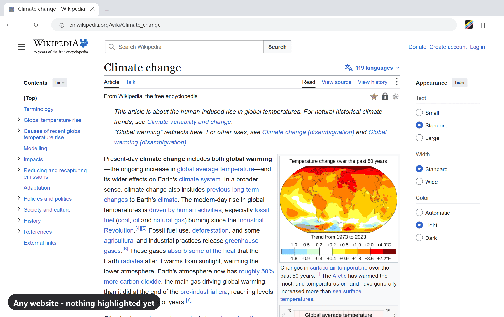
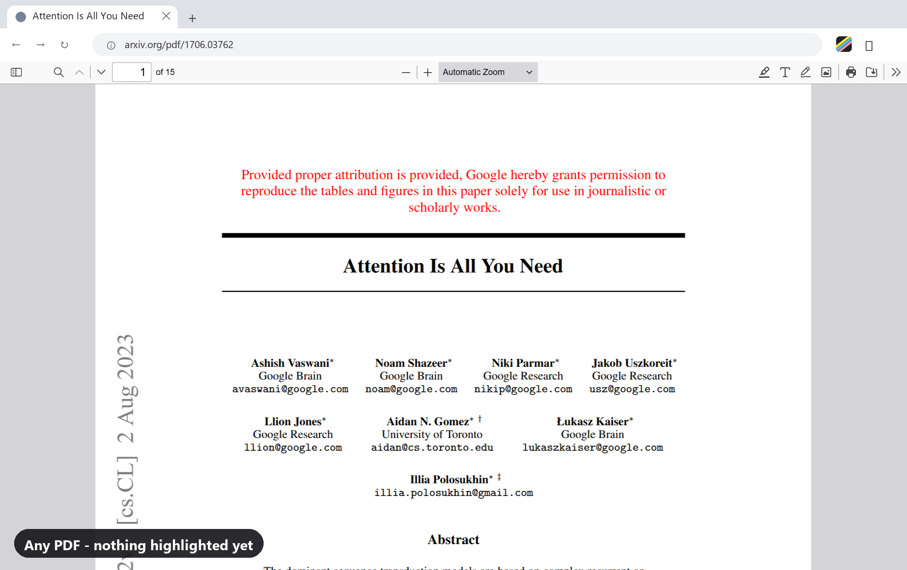

# HueMark

A browser extension that searches for and highlights multiple words or phrases
at once, each in its own color, across:

- **Static pages** — highlighted on load.
- **Dynamically generated pages (SPAs)** — a `MutationObserver` watches for new
  content and highlights it as it appears, so infinite-scroll feeds, chat
  apps, etc. stay highlighted without a manual re-run.
- **Reload persistence** — your term list is saved via `chrome.storage.sync`,
  so every page you (re)load auto-applies the same highlights until you clear
  them.
- **PDFs** — a bundled PDF.js viewer highlights matches in both local and
  http(s) PDFs.
- **Keyboard navigation** — jump between matches and cycle terms without
  touching the mouse (`Alt+Shift+Up/Down/Left/Right`, `Cmd+Shift+...` on Mac),
  with a persistent current-match outline so you never lose your place.
- **Colorblind-friendly palette** — toggle an alternate palette tuned for
  colorblind accessibility.

## Demo

On a web page:



In a PDF:



## Install

- [Chrome Web Store](https://chromewebstore.google.com/detail/huemark-multi-word-highli/fjdhpkmgpfpdaadlennclaecfbeomelf)
- [Microsoft Edge Add-ons](https://microsoftedge.microsoft.com/addons/detail/huemark-multiword-high/kgfekpgoffpafdpopoeelmcnjdpgiakc)
- [Firefox Add-ons](https://addons.mozilla.org/en-US/firefox/addon/huemark-multi-word-highlighter)

## Status: MVP

What works today: any page whose text lives in the real DOM (which is the
vast majority of the web).

## Known limitation: canvas-rendered apps (Google Docs, Google Sheets)

Google Docs and Sheets don't render their content as DOM text — the document
body is a `<canvas>` that Google draws glyphs onto directly, with an
invisible, largely decorative text layer for accessibility/copy-paste. **No
browser extension can inject visual highlights into canvas pixels the way it
can wrap DOM text in a `<mark>`.** This isn't a HueMark gap to fix later, it's
a platform constraint every text-highlighting extension hits (Grammarly, web
clippers, etc. all have the same hole for Docs/Sheets).

Realistic paths forward, if this is still wanted later:
1. **Docs/Sheets Editor Add-on** (separate project, built with Apps Script /
   Google Workspace Editor Add-ons API) — this runs *inside* Docs/Sheets with
   real access to the document model and can apply actual text background
   colors. Different extension surface, different codebase.
2. A "jump to match" experience using each app's native Find (Ctrl+F) driven
   by simulated keystrokes, without true persistent highlighting.

Excel *files* opened locally, and Word documents opened as local files,
aren't reachable by a content script at all (browsers don't run extensions
against `file://` Office documents unless converted to HTML/PDF first).
Whether Excel/Word opened through Office Online exposes accessible DOM text
(vs. canvas rendering, like Docs/Sheets) is unverified — needs investigation
before promising support either way.

## PDF support

Chrome's built-in PDF viewer is itself a separate, sandboxed extension —
third-party content scripts cannot be injected into it, and the API that
would let an extension act as the PDF handler (`mimeHandlerPrivate`) is
Chrome-internal only, not available to third-party extensions. HueMark works
around this by:
- Bundling PDF.js as its own viewer page (`vendor/pdfjs`, shipped in the
  extension and listed in `web_accessible_resources`).
- Redirecting PDF navigations to that bundled viewer via a
  `declarativeNetRequest` rule.
- Letting PDF.js render a real text-layer DOM over the canvas, which
  `highlighter.js`'s existing `highlight()`/`clearHighlights()` targets
  directly with no changes.

Works for both http(s) and local (`file://`) PDFs on Chrome, Edge, and
Firefox.

On Firefox, local PDFs must be opened via the popup's "Open local PDF..."
button, which opens the bundled PDF.js viewer tab — use the viewer's own
"Open File" button from there to pick your file. Firefox tears down the
extension popup the instant a native file picker opens, so the popup's
own in-popup file picker (used on Chrome/Edge) doesn't work there.

## Browser support

| Browser | Status |
|---|---|
| Chrome / Edge | Fully working |
| Firefox | Fully working |
| Safari | Not yet ported |

## Project layout

```
HueMark/
  manifest.json         MV3 manifest
  src/
    background.js         installs default storage state
    highlighter.js         DOM-walking highlight engine (pure, reusable)
    content.js              wires highlighter.js to storage + MutationObserver
    popup.html/css/js       term list + color picker UI
    pdf-picker.js            wires highlighter.js into the bundled PDF.js viewer
  vendor/pdfjs/            bundled PDF.js viewer (see vendor/pdfjs/LICENSE)
  icons/                    toolbar icons
```

## Try it locally

1. Open `chrome://extensions`.
2. Enable **Developer mode** (top right).
3. Click **Load unpacked**, select the `HueMark` folder.
4. Click the HueMark icon, add a couple of words with colors, and open any
   webpage — matches highlight immediately and stay highlighted as the page
   updates or is reloaded.

## Next implementation steps

- [ ] Per-site enable/disable (currently global on/off only).
- [x] Per-term match counts (`current/total`) with next/prev navigation.
- [ ] Overall match total across all terms.
- [x] Saved term lists: save the current terms under a name and load them back from a dropdown in the popup.
- [ ] Import/export of term lists (JSON/CSV) and bulk paste of terms.
- [x] Right-click "add selection to HueMark".
- [x] Scrollbar match markers, colored per term.
- [x] Wildcard support (`*`, `?`, `\` escape) and optional regex (`/pattern/`).
- [ ] Highlight inside input/textarea fields.
- [x] Accent-insensitive matching, always on (Latin and Greek letters, Arabic/Hebrew points; scripts where marks carry meaning are left alone).
- [x] Shadow DOM (open and closed roots) and iframe coverage; counts and next/prev run across the page and its iframes.
- [ ] Performance guardrails for many terms and heavy pages (including a lazy-start option). Deferred: benchmarks show normal pages are fast, and time-slicing makes huge pages slower overall.
- [x] Persistence checks: highlights survive tab switches, idle, popup close, a stopped service worker, reload and back navigation (verified in real Chromium with the unpacked extension).
- [x] Dark mode for the popup (follows the system theme).
- [x] Storage quota check: everything lives in `storage.local` (10 MB), not `storage.sync`; terms are capped at 6 per list, so ~7,500 worst-case saved lists fit. Moving to `storage.sync` would not work as-is (8 KB per item, 100 KB total).
- [x] Export matches with surrounding context: "Copy matches" in the popup copies rich text (bold hits) plus clean plain text, so it pastes into Word, Outlook, Docs or Notepad. One section per term, each match with its surrounding text, the page title and URL. PDFs add page and approximate line numbers; scanned PDFs (no selectable text) say so instead of exporting nothing; output is capped at 500 matches per term. Nothing is saved or sent anywhere, the text goes to your clipboard.
- [ ] Safari port.
- [ ] Consider rewriting the highlight engine on the [CSS Custom Highlight
      API](https://developer.mozilla.org/en-US/docs/Web/API/CSS_Custom_Highlight_API)
      (`CSS.highlights` + `Highlight` + `Range`, Chrome 105+). It paints
      highlights without touching the DOM at all, which sidesteps the
      current approach's main risk on heavily-reactive sites: wrapping text
      in `<mark>` can conflict with React/Vue's own re-rendering of that
      same DOM (reverted highlights, or errors when the framework tries to
      remove a text node HueMark has replaced).

### Not planned

- AI summaries or accounts (no-account is part of the pitch).
- Paywalled PDF or OCR (free PDF support is a differentiator).

## License

MIT — see [LICENSE](LICENSE). The bundled PDF.js (`vendor/pdfjs`) is
Apache-2.0 licensed by Mozilla; see `vendor/pdfjs/LICENSE`.
